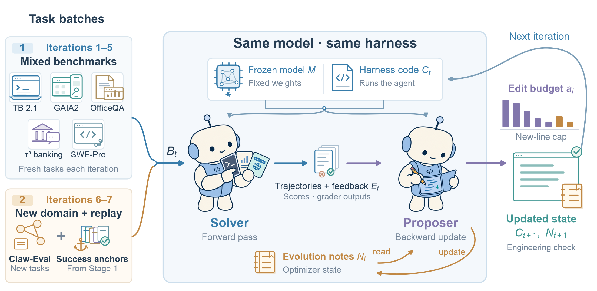
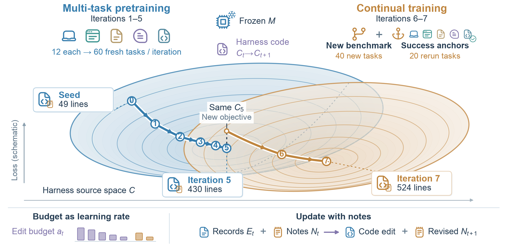
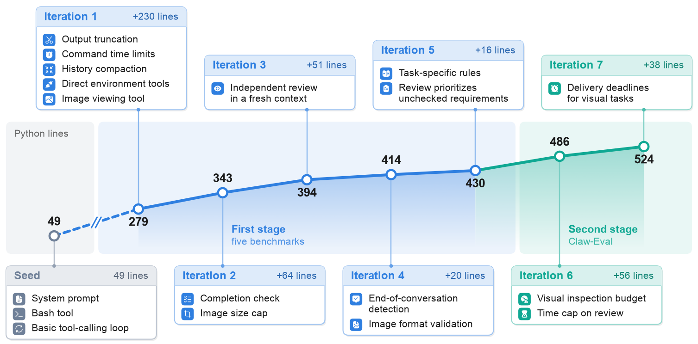

# Multi-Task Self-Evolving Harnesses with the Agent as Its Own Optimizer

Official code for the paper
[Multi-Task Self-Evolving Harnesses with the Agent as Its Own Optimizer](https://arxiv.org/abs/2609.38372).

<p align="center"></p>

A harness is the code around a language-model agent: it organizes prompts, calls tools, manages context and controls
execution. In this framework a single frozen model, running on a single harness, first solves a batch of tasks and
then reads its own run records and edits the harness that runs it. Each batch mixes tasks from five benchmarks in
different domains, and evolution is organized like model training: multi-task pretraining (Iterations 1-5) followed
by continual training on a new domain with replayed success anchors (Iterations 6-7).

<p align="center"></p>

Starting from a 49-line seed, the harnesses evolved by GLM-5.3 and GPT-5.6 Sol gain about 5 points on held-out tasks
of the five training benchmarks, on par with Claude Code and Codex. On five benchmarks never seen during evolution,
the GPT-5.6 Sol harness matches Codex and averages 12.47 points above the seed, with most of that gain coming from
BrowseComp-Plus.

<p align="center"></p>
<p align="center"><em>How the GPT-5.6 Sol harness grew from the seed over seven iterations.</em></p>

## What is in this repository

| Path | Contents |
|---|---|
| `harness_kernel/` | the fixed execution interface: loads a harness, gives it `model.chat` and `world.exec`, records every call |
| `evolution/` | the outer loop: first stage, second stage, held-out evaluation, the update and repair tasks |
| `harnesses/` | the seed harness and the evolved harnesses evaluated in the paper |
| `lineage/` | the harness code after every iteration, with the diff of each iteration |
| `judges/` | host-side grading for GAIA2, Claw-Eval, APEX-Agents and BrowseComp-Plus |
| `adapters/` | builders that turn each benchmark's official release into runnable tasks ([details](adapters/README.md)) |
| `anti_cheat/` | scan of run trajectories for answer lookups |
| `model_clients/`, `configs/` | model clients with the paper's input limit; configurations and task splits |

## Quick start

Requirements: Python 3.12+, [uv](https://docs.astral.sh/uv/), and a sandbox backend supported by
[Harbor](https://github.com/harbor-framework/harbor) (Daytona by default; pass `--env docker` for local Docker).

```bash
uv sync
cp .env.example .env                        # API keys stay on the host
cp providers.example.json providers.json    # model aliases used with --model
```

```bash
# Evaluate a released harness on the held-out tasks
uv run python -m evolution.evaluate --model gpt-5.6-sol-high \
    --workspace harnesses/gpt-5.6-sol/run1-iteration5 --name sol-run1-it5

# First stage: evolve from the seed for five iterations
uv run python -m evolution.stage1 --model gpt-5.6-sol-high --name sol-run1

# Second stage: two more iterations on Claw-Eval
uv run python -m evolution.stage2 --model gpt-5.6-sol-high --stage1 runs/sol-run1 --name sol-run1-stage2

# Offline tests (no model calls, no sandboxes)
uv run --extra dev pytest
```

Everything for one run lands in `runs/<name>/`: the task runs, the update sessions, and every generation of the
harness with its diff. Re-running a command with the same `--name` resumes it.

Benchmarks are not bundled. Terminal-Bench 2.1 runs from Harbor's registry; the others are built from their official
releases with the scripts in [`adapters/`](adapters/README.md). On Daytona, we recommend applying
`patches/harbor-daytona-exec-deadline.patch` to Harbor.

## Citation

```bibtex
@article{xu2026multitask,
  title   = {Multi-Task Self-Evolving Harnesses with the Agent as Its Own Optimizer},
  author  = {Xu, Qiankai},
  journal = {arXiv preprint arXiv:2609.38372},
  year    = {2026}
}
```

## License and acknowledgements

Released under the [Apache License 2.0](LICENSE). The code runs on [Harbor](https://github.com/harbor-framework/harbor);
`adapters/gaia2/are_mcp_server.py` is adapted from Harbor's GAIA2 adapter (Apache-2.0), and
`judges/gaia2_worker.py` includes a function adapted from [RHO](https://github.com/wbopan/retro-harness) (MIT).
Benchmark data, graders and environments belong to their respective authors and are downloaded from their official
sources. Icons in the figures are UIcons by [Flaticon](https://www.flaticon.com/uicons).
